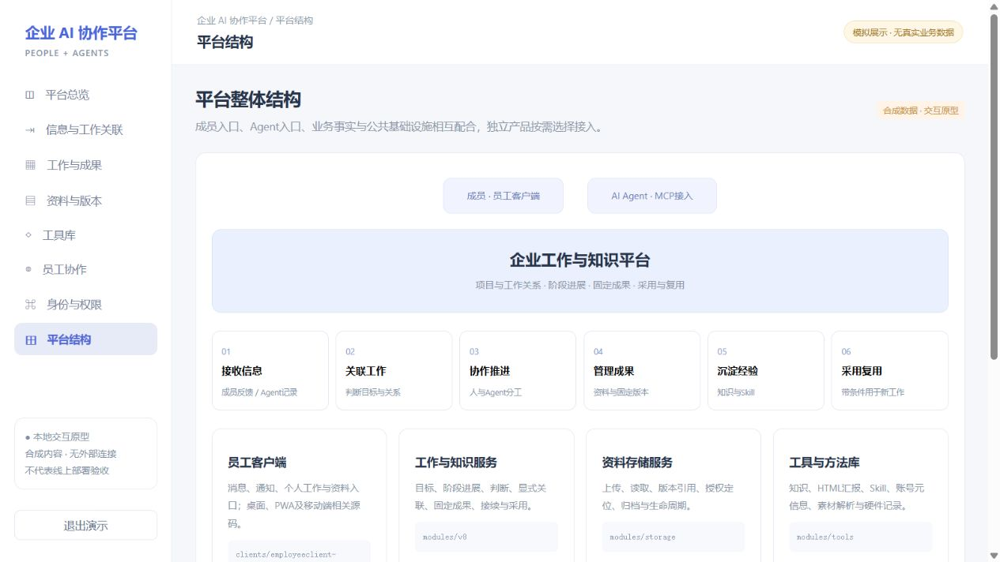

# 企业 AI Agent 协作与知识平台

**Enterprise AI Workspace — a shared workspace for people, AI agents, knowledge and reusable skills.**

面向团队与 AI Agent 的企业工作与知识平台，覆盖成员协作、工作推进、资料与成果、知识沉淀、工具及 Skill 复用，并提供身份权限、Agent接入和持续执行等公共基础能力。它将分散的信息和多轮工作组织成可查找、可接续、可采用的业务依据，服务团队的日常运行与多个AI项目。

成员通过员工客户端接收消息、查看工作与资料，Agent通过MCP使用当前授权能力；工作服务组织目标、阶段和关系，资料服务保存原件与版本，工具库集中管理知识、方法与能力入口。各模块共同支持协作，也允许独立业务产品按需接入。

[本地演示](#快速体验) · [完整平台结构](docs/platform-architecture.md) · [工具库详解](docs/tools-library.md) · [源码运行说明](docs/getting-started.md) · [发布范围](SOURCE_SNAPSHOT.md)


## 产品解决什么问题

团队同时推进多个 AI 项目时，需求说明、反馈、讨论结论、执行记录和成果容易分散；新成员或新的 Agent 会话需要重新整理背景，做过的方法也难以持续复用。

平台以具体工作为组织单位：接收成员或 Agent 提交的需求说明、工作记录及资料引用，将其关联到工作与项目；人与 Agent 推进执行，保留过程和阶段成果；再把可采用的经验整理为知识，把稳定的方法沉淀为 Skill，供后续任务检索和选用。信息来源及关联由具体入口与使用者确定，不假设所有外部信息都已自动采集、自动关联。

## 核心能力

| 场景 | 平台提供的能力 | 主要实现 |
| --- | --- | --- |
| 将信息变成可推进的工作 | 工作关联、阶段记录、上下文接续与任务状态 | V8、员工客户端、MCP |
| 多人和 Agent 协作 | 成员消息、通知、工作入口与受控工具调用 | 员工客户端、共享 Worker |
| 管理资料与成果 | 文件上传、版本引用、权限校验和存储生命周期 | 资料存储服务、身份权限服务 |
| 复用知识与执行方法 | 经验整理、知识检索、工具登记和 Skill 选用 | V8、工具库、Skills |
| 控制访问和执行边界 | 成员身份、项目权限、授权和执行回执 | 身份权限服务、MCP、Worker |
| 支撑企业日常运行 | 成员工作清单、任务与提案、阶段回执、问题反馈和发布手册 | 任务、反馈、成员工作及手册模块 |
| 按需接入公共能力 | 项目工程、数据库与云资源、素材及生成适配 | 工程／资源模块、工具连接器 |

模块齐备不等于所有环节都自动闭环：经验是否适用、知识是否被采用、Skill执行结果是否合格，仍需相应判断与验证。


## 一条完整的工作链路

| 环节 | 具体处理什么 | 下一环节如何使用 |
| --- | --- | --- |
| 信息接收与整理 | 成员提交的需求、体验反馈，Agent主动保存的阶段记录，上传的文档与资料引用 | 区分来源、判断、待办和未知信息，判断已有工作或独立目标 |
| 关联到工作 | 按实际目标关联项目、阶段、相关工作与依据，不只看主题相似 | 人与Agent基于同一目标继续推进 |
| 协作推进 | 保存进展、判断、纠正、异常与下一步，成员通过客户端沟通，Agent使用受控能力 | 形成可以交接和继续处理的工作视图 |
| 管理资料与成果 | 原件保存、固定版本、授权定位及阶段成果引用 | 后续读取同一份依据，区分最新修订和已采用版本 |
| 沉淀知识与Skill | 经验保留来源、适用条件与限制；稳定方法组织为带步骤和检查点的方法包 | 后续任务先查找、阅读，再判断是否适用 |
| 在新工作中采用 | 记录采用用途和固定成果，选用适用的方法继续执行 | 逐步减少重复背景整理、同类问题纠正和成熟流程的重新拆解 |

软件开发、视频制作、产品体验迭代等可以分别沉淀经验与执行方法，并非只对UI生成或任务交接有价值。自动关联、知识有效性、采用结果及Skill执行成功仍需要对应判断与验证，不将模块存在直接写成全部自动闭环。

## 工具库：不止是工具列表

工具库提供网页与Agent两类入口，覆盖 **知识、HTML汇报、Skill、账号非敏感资料、素材解析与清单、硬件记录** 六类模块。

知识条目保留正文、来源、适用范围、限制与修订信息；Skill描述可重复采用的工作方法；HTML汇报保留可阅读成果。账号、素材与硬件模块为授权范围内的工作提供资源信息，但不因目录可见就交付凭据、下载文件或完成采购。


原型可以搜索、按六类模块筛选、阅读条目版本与输入输出，并将知识／方法在本页关联到示例工作。真实业务模块及原网页源码均保留，见 [工具库的对象、接线与恢复机制](docs/tools-library.md)。

工具库既可通过中枢MCP适配，也有独立stdio连接器。Agent可以通过接口发现能力、查询知识、保存报告或导入方法包，业务权限仍由实际服务检查。保存、核对、采用、安装和执行各自成立，不互相替代。

## 各结构怎样配合

| 结构 | 职责 | 源码入口 |
| --- | --- | --- |
| 员工客户端 | 成员消息、通知、工作与资料入口；桌面／PWA／移动相关实现 | [clients](clients) |
| 工作与知识服务 | 项目、阶段、上下文、工作关系和采用 | [modules/v8](modules/v8) |
| 资料存储服务 | 原件、固定版本、读取资格与生命周期 | [modules/storage](modules/storage) |
| 工具与方法库 | 知识、报告、Skill及资源元信息，网页与Agent接入 | [modules/tools](modules/tools)、[skills](skills) |
| 身份权限服务 | 成员身份、项目资格、授权撤销与受保护资源交付 | [hufu](modules/hub/apps/hufu)、[authorization](modules/hub/packages/authorization) |
| MCP接入层 | 能力发现、契约、身份传递与受控调用 | [mcp](modules/hub/apps/mcp)、[mcp-edge](modules/hub/packages/mcp-edge) |
| 共享执行器 | 持续任务、租约、重试、操作回执及事件投递 | [modules/worker](modules/worker) |
| 企业运行与公共扩展 | 任务／提案、成员回执、问题反馈、手册与发布；工程、数据库及外部能力适配 | [功能索引](modules/hub/packages/handbook/current/function-index.md)、[平台详解](docs/platform-architecture.md) |



完整对象关系、信息来源、各模块边界和源码定位见 [平台结构详解](docs/platform-architecture.md)。源码中的服务基线、较新独立快照、候选改动和实际部署状态分别说明；不将所有适配器都描述为当前已连通的线上服务。

## 可以重点阅读的设计

- **工作与上下文有明确关系**：工作关联不仅依赖主题相似；阶段记录、资料引用和采用关系共同提供接续依据。
- **资料引用与当前版本区分**：对阶段成果保留固定版本引用，支持后续查找、使用和追溯。
- **经验与 Skill 分层复用**：经验说明适用条件和判断，Skill描述执行方法；不把每次反馈直接当成通用规则。
- **身份与执行相互约束**：工具可被发现不代表可任意使用；身份、项目授权与执行范围共同决定可执行操作。

## 快速体验

需要 Node.js 20+，无须安装依赖或配置数据库：

```bash
git clone https://github.com/Ramenne/enterprise-ai-agent-workspace.git
cd enterprise-ai-agent-workspace
npm run demo
```

打开 **http://127.0.0.1:4173**，使用 **demo / demo-only** 登录。八个页面覆盖总览、信息关联、工作与成果、资料与版本、工具库、员工协作、身份权限及平台结构。[演示操作说明](docs/demo.md)

截图来自仓库中的独立交互原型，全部统计与业务数据均为模拟。原员工客户端前端和服务端源码在下方目录，不以此原型代替原系统。

## 源码结构

```text
clients/
  employeeclient-desktop/  员工客户端桌面端相关源码
  employeeclient-mobile/   员工客户端移动端、PWA与Android相关源码
modules/
  hub/              MCP、身份权限服务及中枢服务基线
  v8/               工作、记录、关联与经验模块的独立快照
  storage/          资料存储服务独立快照
  worker/           共享执行器相关快照
  tools/            工具库、连接器与适配器
skills/             工作关联、经验沉淀及方法复用等Skill
demo/               无外部连接的独立展示原型
docs/               架构、启动边界与展示说明
```

Node.js / TypeScript、Fastify、PostgreSQL、MCP、Vue 3、Pinia、Vite，以及 PWA / Capacitor 构成主要实现。各子目录来自独立导出的源码快照，存在共享基线及重复文件，并非已重新统一装配的单一 monorepo；[部署原系统前先读运行边界](docs/getting-started.md)。

## 发布与许可

本次为 **2026-10-24 首次公开整理快照**。发布前替换了内部地址与标识，移除了凭据、捕获数据、历史资料索引和部分部署专用记录；原始 Git 历史及生产数据未发布。

自研部分使用 [Apache-2.0](LICENSE)，内嵌第三方代码与依赖遵循各自许可，见 [第三方说明](THIRD_PARTY_NOTICES.md)。

维护与部署注意事项见 [SECURITY.md](SECURITY.md)。
