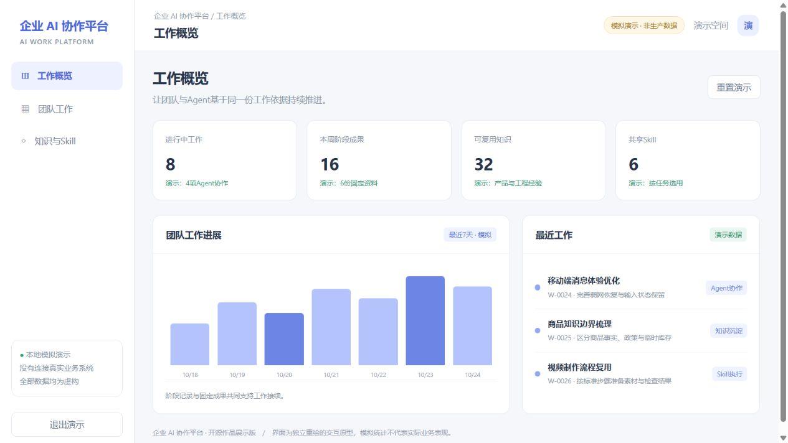
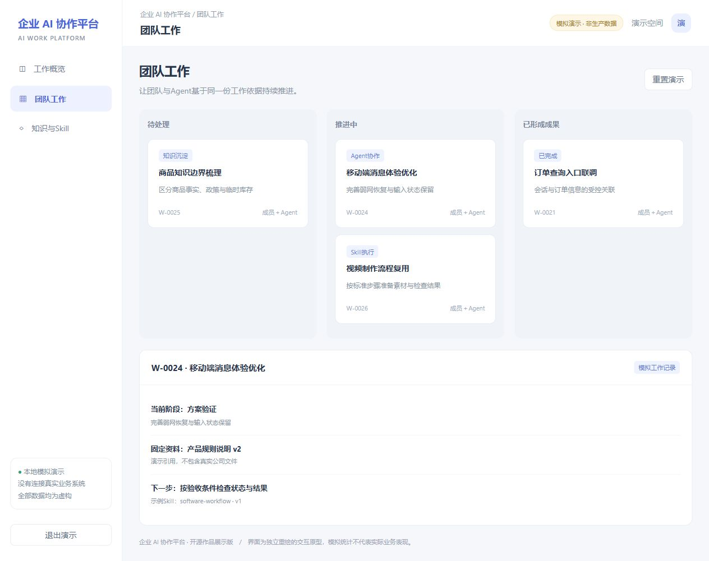

# 企业 AI Agent 协作与知识平台

**Enterprise AI Workspace — a shared workspace for people, AI agents, knowledge and reusable skills.**

面向团队与 AI Agent 的企业工作与知识平台，把分散的信息、工作过程、资料、阶段成果与可复用经验组织在同一套工作关系中。成员通过员工客户端协作，Agent 通过 MCP 接入，使后续工作能够找到已有依据、继续推进并复用方法。

[本地演示](#快速体验) · [架构与源码导航](docs/architecture.md) · [源码运行说明](docs/getting-started.md) · [发布范围](SOURCE_SNAPSHOT.md)



## 产品解决什么问题

团队同时推进多个 AI 项目时，需求说明、反馈、讨论结论、执行记录和成果容易分散；新成员或新的 Agent 会话需要重新整理背景，做过的方法也难以持续复用。

平台以具体工作为组织单位：接收成员或 Agent 提交的需求说明、工作记录及资料引用，将其关联到工作与项目；人与 Agent 推进执行，保留过程和阶段成果；再把可采用的经验整理为知识，把稳定的方法沉淀为 Skill，供后续任务检索和选用。信息来源及关联由具体入口与使用者确定，不假设所有外部信息都已自动采集、自动关联。

## 核心能力

| 场景 | 平台提供的能力 | 主要实现 |
| --- | --- | --- |
| 将信息变成可推进的工作 | 工作关联、阶段记录、上下文接续与任务状态 | V8、员工客户端、MCP |
| 多人和 Agent 协作 | 成员消息、通知、工作入口与受控工具调用 | 员工客户端、共享 Worker |
| 管理资料与成果 | 文件上传、版本引用、权限校验和存储生命周期 | 资料存储服务、身份权限服务 |
| 复用知识与执行方法 | 经验整理、知识检索、工具登记和 Skill 选用 | V8、工具库、Skills |
| 控制访问和执行边界 | 成员身份、项目权限、授权和执行回执 | 身份权限服务、MCP、Worker |

模块齐备不等于所有环节都自动闭环：经验是否适用、知识是否被采用、Skill执行结果是否合格，仍需相应判断与验证。



## 可以重点阅读的设计

- **工作与上下文有明确关系**：工作关联不仅依赖主题相似；阶段记录、资料引用和采用关系共同提供接续依据。
- **资料引用与当前版本区分**：对阶段成果保留固定版本引用，支持后续查找、使用和追溯。
- **经验与 Skill 分层复用**：经验说明适用条件和判断，Skill描述执行方法；不把每次反馈直接当成通用规则。
- **身份与执行相互约束**：工具可被发现不代表可任意使用；身份、项目授权与执行范围共同决定可执行操作。

## 快速体验

需要 Node.js 20+，无须安装依赖或配置数据库：

```bash
git clone https://github.com/Ramenne/enterprise-ai-agent-workspace.git
cd enterprise-ai-agent-workspace
npm run demo
```

打开 **http://127.0.0.1:4173**，使用 **demo / demo-only** 登录。[演示操作说明](docs/demo.md)

截图来自仓库中的独立交互原型，全部统计与业务数据均为模拟。原员工客户端前端和服务端源码在下方目录，不以此原型代替原系统。

## 源码结构

```text
clients/
  employeeclient-desktop/  员工客户端桌面端相关源码
  employeeclient-mobile/   员工客户端移动端、PWA与Android相关源码
modules/
  hub/              MCP、身份权限服务及中枢服务基线
  v8/               工作、记录、关联与经验模块的独立快照
  storage/          资料存储服务独立快照
  worker/           共享执行器相关快照
  tools/            工具库、连接器与适配器
skills/             工作关联、经验沉淀及方法复用等Skill
demo/               无外部连接的独立展示原型
docs/               架构、启动边界与展示说明
```

Node.js / TypeScript、Fastify、PostgreSQL、MCP、Vue 3、Pinia、Vite，以及 PWA / Capacitor 构成主要实现。各子目录来自独立导出的源码快照，存在共享基线及重复文件，并非已重新统一装配的单一 monorepo；[部署原系统前先读运行边界](docs/getting-started.md)。

## 发布与许可

本次为 **2026-10-24 首次公开整理快照**。发布前替换了内部地址与标识，移除了凭据、捕获数据、历史资料索引和部分部署专用记录；原始 Git 历史及生产数据未发布。

自研部分使用 [Apache-2.0](LICENSE)，内嵌第三方代码与依赖遵循各自许可，见 [第三方说明](THIRD_PARTY_NOTICES.md)。

维护与部署注意事项见 [SECURITY.md](SECURITY.md)。
