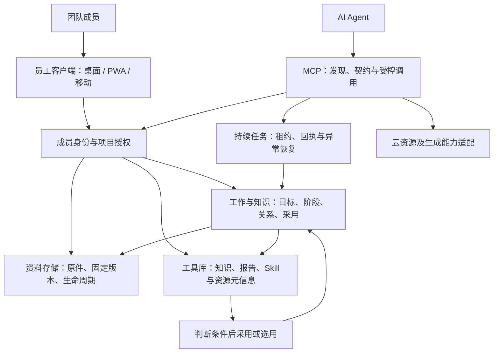

# 平台结构、对象关系与源码导航

这是面向团队与Agent的企业工作与知识平台。工作看板只是其中一个视图；平台同时提供成员入口、身份权限、资料原件、工作关系、工具与方法复用、执行接续和公共资源能力。

本文按公开源码及随包手册解释职责。不同日期的手册、源码候选和独立快照不等于本次实时部署验证。

## 整体结构

箭头表示协作、调用或引用，不代表所有业务都经过单一网关，也不代表整个过程自动发生。独立产品可以只接入身份、存储或某项公共能力，保留自己的业务数据库与部署方式。

## 信息接收：什么进来、怎样整理、支持什么行动

| 输入 | 可核对的来源／入口 | 整理与关联 | 后续行动 |
| --- | --- | --- | --- |
| 业务目标、体验反馈和问题说明 | 成员提交、项目反馈入口、Agent主动保存 | 区分目标、反馈、判断和待核实项；判断属于已有工作还是独立目标 | 调整方案、确定下一步或建立独立工作 |
| 阶段进展与判断依据 | 工作保存／阶段提交接口 | 追加阶段，保留边界、关系与未完成事项 | 跨成员、跨会话继续推进 |
| 文档、报告和附件 | 资料上传、HTML汇报与显式引用 | 原件放资料服务，工作记录引用固定版本 | 阅读原文、核对依据、验收阶段成果 |
| 可复用经验与方法 | 人或Agent整理后写入知识／导入Skill | 保留来源、条件、限制、修订身份和版本 | 检索、阅读、判断采用或选用 |
| 素材等外部信息 | 对应解析适配器 | 保留来源与选中清单 | 按授权下载、处理与使用 |

完整原文、摘要、可见片段和未知覆盖范围要区分。平台没有因此自动捕获全部客户端对话，也不宣称默认采集微信或所有业务系统的信息。

相同主题不是相同工作。同一目标沿原工作追加，独立目标另建工作，直接关系需要依据。参见 [工作手册](../modules/hub/packages/handbook/current/v8-guide.md) 与 [关联判断方法](../skills/v8-work-link-judgment/SKILL.md)。

## 平台对象与数据职责

| 对象 | 管什么 | 与什么区分 |
| --- | --- | --- |
| 项目 | 业务范围、成员资格、可见性 | 项目可见性不自动赋予服务器权限 |
| 工作 | 持续目标、状态、阶段、关系和责任 | 一次对话不必建立一个新项目 |
| 阶段记录 | 实际进展、判断依据、纠正、待办和下一步 | 提交完成声明不证明外部部署或付款完成 |
| 资料与固定版本 | 原件、来源、版本和读取资格 | 最新修订不自动替换原有采用 |
| 采用关系 | 使用哪个固定成果、用途与依据 | 保存、检索、阅读、采用分别成立 |
| 知识 | 条件、经验、来源、限制和证据状态 | 整理过不代表普遍适用或已验证 |
| Skill | 方法包、输入输出、执行步骤和检查点 | 导入不等于安装或执行成功 |
| 操作与回执 | 请求标识、身份、进度和确定结果 | 生成内容不等于外部动作已经发生 |

## 各结构与源码

| 结构 | 业务职责和主要实现 | 阅读入口 |
| --- | --- | --- |
| 员工客户端 | 消息、通知、个人工作、资料入口，桌面／PWA／Android相关实现；普通聊天状态独立于工作事件投递 | [桌面](../clients/employeeclient-desktop)、[移动](../clients/employeeclient-mobile)、[成员工作手册](../modules/hub/packages/handbook/current/member-work.md) |
| 工作与知识服务 | 项目、阶段、上下文接续、显式关联和采用；接续包保留判断、边界、固定成果及下一步 | [V8独立快照](../modules/v8)、[共享基线服务](../modules/hub/apps/v8)、[工作手册](../modules/hub/packages/handbook/current/v8-guide.md) |
| 资料存储 | 上传、授权定位、原件、版本及生命周期；分类、归档、主读位置和清理分别处理 | [存储快照](../modules/storage)、[资料服务](../modules/hub/apps/mem)、[存储手册](../modules/hub/packages/handbook/current/material-storage.md) |
| 工具库与方法库 | 六类业务模块、知识维护、方法包、报告和资源元信息，网页与MCP两类使用入口 | [工具库详解](tools-library.md)、[业务模块](../modules/tools/components/accounts)、[Skill集合](../skills) |
| 身份与授权 | 成员、项目资格、授权撤销、凭据交付；发现工具、读取资料和执行操作分别检查 | [身份服务](../modules/hub/apps/hufu)、[授权模块](../modules/hub/packages/authorization) |
| MCP接入 | 能力发现、契约、身份传递及受控调用；不把目录可见当作任意执行权限 | [MCP服务](../modules/hub/apps/mcp)、[网关](../modules/hub/packages/mcp-edge/source)、[独立TOOLS连接器](../modules/tools/connectors/workspace-tools-mcp) |
| 共享执行器 | 持续任务、租约、重试、结果与事件投递；未知结果按原请求接续核对 | [Worker快照](../modules/worker)、[实现与候选说明](../modules/hub/apps/worker) |
| 工程／数据库／资源 | 项目范围内工程执行、结构查询、共享资源适配与恢复，不自动开放整机权限 | [工程手册](../modules/hub/packages/handbook/current/project-engineering.md)、[数据库权限](../modules/hub/packages/handbook/current/database-permissions.md)、[运行说明](../modules/hub/packages/handbook/current/operations.md) |
| 团队运行 | 任务、提案、成员回执、积分及现金应付、项目反馈、成员工作事实与理解、手册和发布档案 | [任务与回执](../modules/hub/packages/handbook/current/task-points.md)、[项目反馈](../modules/hub/packages/handbook/current/project-feedback.md)、[总索引](../modules/hub/packages/handbook/current/function-index.md) |
| 生成与其他扩展 | 云资源、视觉生成、画廊及音频等适配；供应商资格、预算、部署与最终结果分别验证 | [适配源码](../modules/tools/src)、[集成边界](../modules/hub/packages/handbook/current/integrations.md) |

任务账目、应付记录和真实付款仍需区分。公开原型不展示真实人员、薪资、账号密码或业务记录。源码存在也不代表所有外部供应商已授权并可用。

## 示例：怎样从一次反馈积累到下一次工作

以移动端中断后输入丢失为说明场景（原型为合成内容）：

1. 成员提交体验反馈，Agent提交定位与阶段进展，不假设自动捕获完整对话。
2. 判断属于已有消息体验工作，追加来源和问题，避免重复开工作。
3. 人与Agent推进方案，形成验收说明等固定成果。
4. 整理“什么情况下保留输入、怎样核对发送状态”等带条件的知识，不概括成任何重连都重发。
5. 选用稳定的开发／验收Skill。软件开发、视频制作等可以分别沉淀方法，不局限于UI。
6. 后续任务检索、阅读限制并采用适用知识，保留采用版本；新修订不会自动改变原工作依据。

价值在于减少重新寻找背景、重复纠正相同问题和重新拆解成熟流程。缺少统一记录时，不在这里虚构提效百分比。

## 快照与验收

hub和worker存在共享基线，独立v8、storage目录可能来自其他阶段，不能据目录齐备断言版本已统一装配，更不能将所有SQL直接运行到现有生产库。公开版已替换内部标识、清空历史业务索引。

八页原型验证的是本地交互，不是全部服务线上连通。部署限制见 [启动说明](getting-started.md) 和 [源码范围](../SOURCE_SNAPSHOT.md)。
