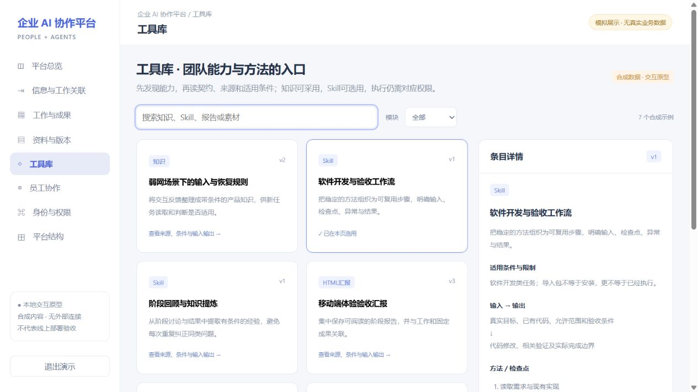

# 工具库：知识、方法与能力的发现和复用

工具库同时管理可阅读的知识与汇报、可选用的方法包，以及当前成员可读取的资源元信息。工作服务保存业务事实，资料服务保存原件，工具库提供内容维护与复用入口。

## 六类模块

| 模块 | 对象与能力 | 主要边界 | 源码 |
| --- | --- | --- | --- |
| 知识 | 经验、规则、来源、适用条件；列表、读取、保存与revision修订 | 保存不等于验证或采用 | [knowledge-library.mjs](../modules/tools/components/accounts/knowledge-library.mjs) |
| HTML汇报 | 阶段报告、HTML原件、索引与读取 | 保存保真与业务采用分别核对 | [html-library.mjs](../modules/tools/components/accounts/html-library.mjs) |
| Skill | 方法包、正文、附件与版本，读取／导入／版本维护 | 不自动安装或执行导入包 | [skill-library.mjs](../modules/tools/components/accounts/skill-library.mjs)、[包处理](../modules/tools/components/accounts/skill-package.mjs) |
| 账号非敏感资料 | 服务用途、定位和当前成员可读的元信息 | 不向模型交付密码、Cookie或受保护备注 | [账号模块](../modules/tools/components/accounts) |
| 素材解析与清单 | 来源、候选项和选中清单 | 清单不等于本机下载或文件合并完成 | [连接器说明](../modules/tools/connectors/workspace-tools-mcp/README.md) |
| 硬件记录 | 设备、配置与采购相关记录 | 记录操作不等于下单、付款或交付 | [hardware.mjs](../modules/tools/components/accounts/hardware.mjs) |

## 网页与MCP怎样连接

已有 [知识库网页](../modules/tools/components/accounts/knowledge-library-web)、[Skill库网页](../modules/tools/components/accounts/skill-library-web)、[HTML库网页](../modules/tools/components/accounts/html-library-web)、[硬件网页](../modules/tools/components/accounts/hardware-web) 等源码。

中枢适配层负责发现、身份传递和调用包装；业务服务仍维护内容、权限与版本。独立stdio连接器可让Agent通过HTTPS调用已开放能力，不依赖Computer Use或任务大厅进程。不同接入路径的候选、部署和验收状态分别核对，不能相互代替。

## 知识与Skill如何复用

知识需要正文、来源、适用范围、限制、证据状态、标签与修订信息。已有条目按原id和revision修订，不按标题猜测并不断新增副本。先检索候选，再读正文和限制，最后判断采用。

当前有限筛选不能描述成全库语义RAG、后端分页或持久变化游标。Skill则明确方法步骤、输入输出与检查点，软件开发、视频制作、体验规则整理与阶段回顾可以分别沉淀；平台不因此保证所有方法无人值守执行。

## 写入与恢复

连接器使用当前成员身份，不共享管理员凭据；写入保持稳定请求标识。未知效果先查原回执或继续核对，不换标识重复新增。保存成功与读回核对分别表达，saved_verification_pending不等于完整核验成功。

本机上传目录只控制本机读取范围，线上写入资格仍由当前身份决定；Skill包中的内容不是额外授权。详见 [独立连接器](../modules/tools/connectors/workspace-tools-mcp/README.md)。

## 原型操作

搜索“工作流”或“恢复”，按六类模块筛选；选择条目查看版本、来源、适用限制、输入输出、步骤和源码对应。采用知识／选用方法后，到“工作与成果”核对本页关联结果。其他记录仅生成示例回执。

独立重绘原型不等于原线上界面。条目和状态均为合成数据，页面刷新后清空；不写真实知识、不安装Skill、不调用模型或读取真实账号。
